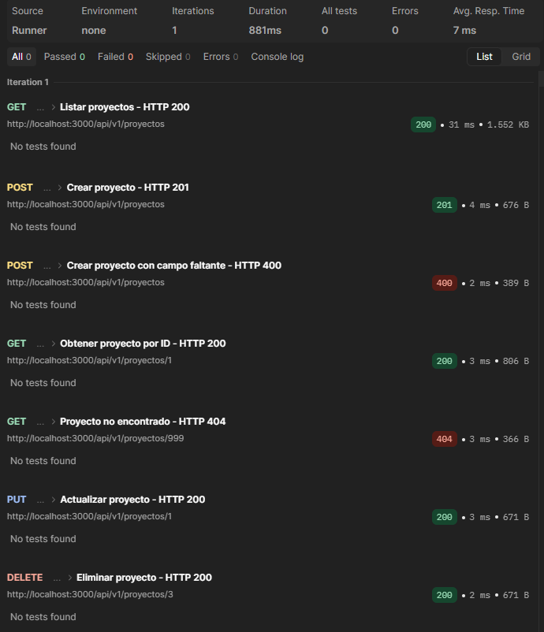
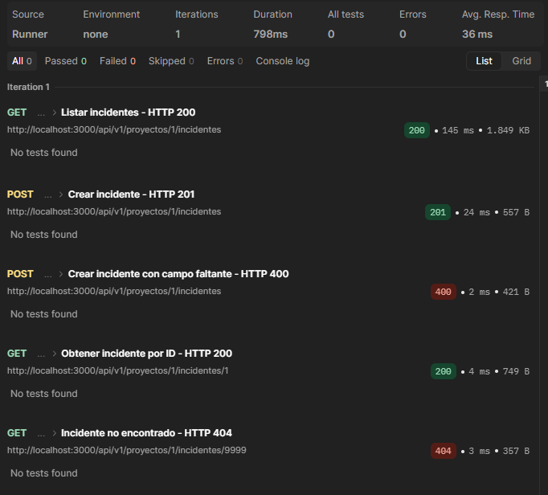
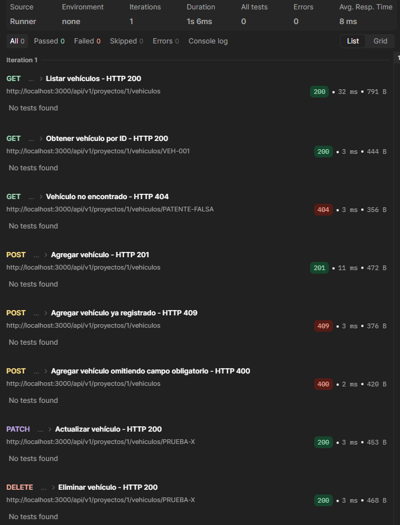
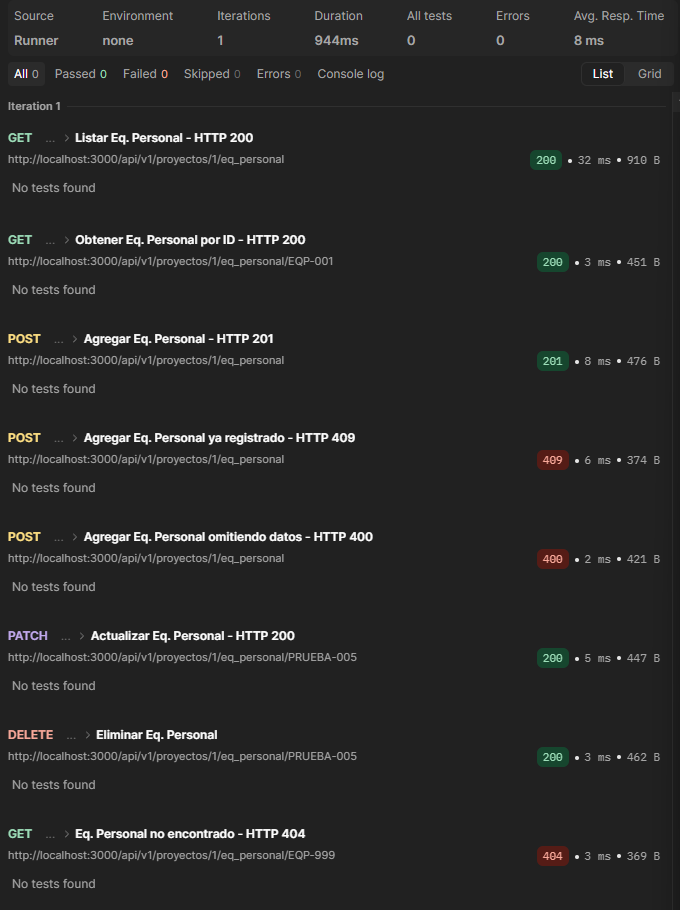
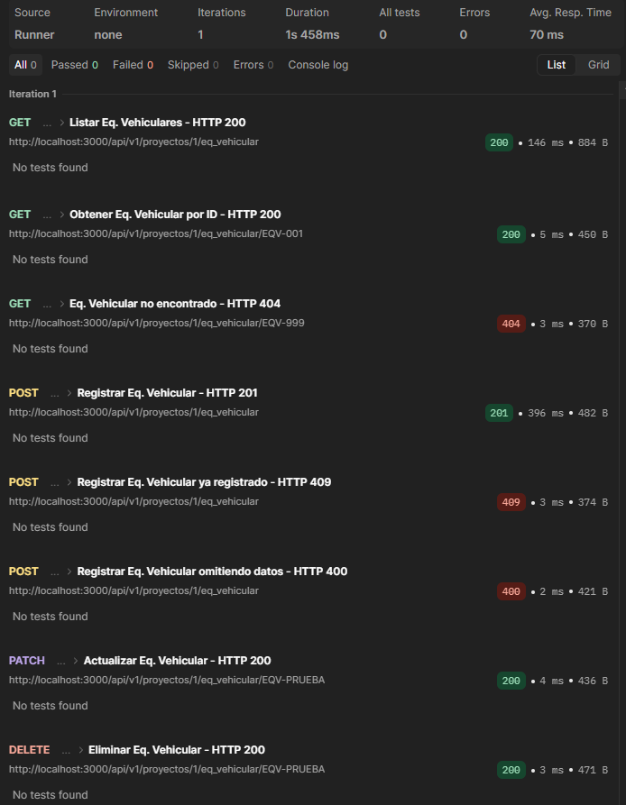
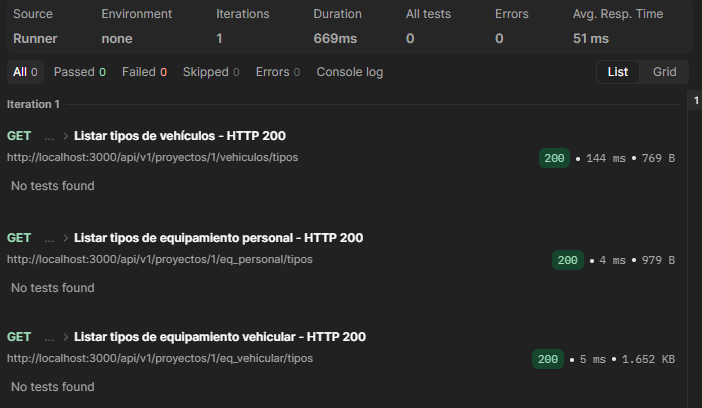

# Módulo de proyectos
Módulo encargado de la gestión completa de proyectos de patrullaje. Incluyendo operaciones de creación, listado, obtención por ID, actualización y eliminación.

## 1. Listar todos los proyectos
Obtiene un listado de todos los proyectos activos que no hayan sido eliminados lógicamente.

Método: `GET`  
Ruta: `/api/v1/proyectos`  
Autenticación: Requiere Token JWT  
Roles permitidos: `admin`, `supervisor`  
Parámetros: Ninguno  

Respuestas Esperadas:  
- 200 OK: Devuelve la lista con los proyectos encontrados.

```JSON
{
"ok": true,
"message": "Proyectos obtenidos correctamente.",
"data": [ ... ]
}
```

Casos de Error:  
- 404 Not Found: No hay proyectos registrados en el sistema.
- 500 Internal Server Error: Error interno del servidor al procesar la solicitud.

## 2. Crear un proyecto
Registra un nuevo proyecto de patrullaje en la base de datos.

Método: `POST`  
Ruta: `/api/v1/proyectos`  
Autenticación: Requiere Token JWT  
Roles permitidos: `admin`  
Body requerido (JSON):  

```JSON
{
  "nombre_proyecto": "string",
  "nombre_sector": "string",
  "presupuesto": "number",
  "fecha_inicio": "string (YYYY-MM-DD)",
  "fecha_termino": "string (YYYY-MM-DD)",
  "zona_seleccionada": "any (coordenadas o datos de zona)"
}
```
Respuestas Esperadas:  
- 201 Created: Proyecto creado exitosamente.

```JSON
{
  "ok": true,
  "message": "Proyecto creado correctamente.",
  "data": { ... }
}
```
Casos de Error:  
- 400 Bad Request: Faltan datos obligatorios en el cuerpo de la petición.
- 500 Internal Server Error: Error interno al intentar guardar el proyecto.

## 3. Obtener un proyecto por ID
Busca y devuelve los detalles de un proyecto específico a través de su identificador único.  

Método: `GET`  
Ruta: `/api/v1/proyectos/:id_proyecto`  
Autenticación: Requiere Token JWT.  
Roles permitidos: `admin`, `supervisor`  
Parámetros de ruta (Path Params):
- `id_proyecto` (number): ID único del proyecto.  

Respuestas Esperadas:  
- 200 OK: Devuelve los datos del proyecto encontrado.

```JSON
{
  "ok": true,
  "message": "Proyecto encontrado correctamente.",
  "data": { ... }
}
```
Casos de Error:  
- 400 Bad Request: El ID proporcionado no es válido o no es numérico.
- 404 Not Found: El proyecto solicitado no existe o ya fue eliminado.
- 500 Internal Server Error: Error interno del servidor.

## 4. Actualizar un proyecto
Modifica los datos de un proyecto existente.  

Método: `PUT`  
Ruta: `/api/v1/proyectos/:id_proyecto`  
Autenticación: Requiere Token JWT.  
Roles permitidos: `admin`  
Parámetros de ruta (Path Params):  
- `id_proyecto` (number): ID único del proyecto a actualizar.  

Body (JSON):  
```JSON
{
  "nombre_proyecto": "string",
  "nombre_sector": "string",
  "presupuesto": "number",
  "fecha_inicio": "string",
  "fecha_termino": "string",
  "zona_seleccionada": "any",
  "activo": "boolean"
}
```
Respuestas Esperadas:  
- 200 OK: Proyecto actualizado correctamente.

```JSON
{
  "ok": true,
  "message": "Proyecto actualizado correctamente.",
  "data": { ... }
}
```
Casos de Error:  
- 400 Bad Request: El ID enviado en la ruta no es válido.
- 404 Not Found: El proyecto no existe o ya fue eliminado.
- 500 Internal Server Error: Error interno al actualizar.

## 5. Eliminar un proyecto (Eliminación lógica)
Realiza una baja lógica del proyecto cambiando su estado de eliminación a verdadero (eliminado = true).  

Método: `DELETE`  
Ruta: `/api/v1/proyectos/:id_proyecto`  
Autenticación: Requiere Token JWT.  
Roles permitidos: `admin`  
Parámetros de ruta (Path Params):  
- `id_proyecto` (number): ID único del proyecto.  

Respuestas Esperadas:  
- 200 OK: Proyecto marcado como eliminado correctamente.

```JSON
{
  "ok": true,
  "message": "Proyecto eliminado correctamente.",
  "data": { ... }
}
```
Casos de Error:  
- 400 Bad Request: Faltan datos o el ID no es válido.  
- 404 Not Found: El proyecto no existe o ya se encontraba eliminado.  
- 500 Internal Server Error: Error del servidor al procesar la eliminación.  

### Evidencia de pruebas en Postman 


# Módulo de incidentes
Este módulo gestiona el registro, listado y consulta detallada de los incidentes reportados durante los patrullajes.  

## 1. Listar todos los incidentes de un proyecto
Obtiene un listado de todos los incidentes asociados a un proyecto específico, cruzando la información con sus respectivos patrullajes y categorías.  

Método: `GET`  
Ruta: `/api/v1/proyectos/:id_proyecto/incidentes`  
Autenticación: Requiere Token JWT.  
Roles permitidos: `admin`, `supervisor`  
Parámetros de ruta (Path Params):  
- `id_proyecto` (number): ID único del proyecto.  

Respuestas Esperadas:  
- 200 OK: Devuelve la lista con los incidentes encontrados.

```JSON
{
  "ok": true,
  "message": "Incidentes obtenidos correctamente.",
  "data": [ ... ]
}
```
Casos de Error:  
- 400 Bad Request: El ID del proyecto no es válido o no es numérico.
- 404 Not Found: El proyecto no existe o no hay incidentes registrados para este proyecto.
- 500 Internal Server Error: Error interno del servidor o de base de datos.

## 2. Obtener un incidente específico por ID
Busca y devuelve los detalles completos de un incidente en particular (incluyendo su fotografía opcional) validando que pertenezca al proyecto indicado.  

Método: `GET`  
Ruta: `/api/v1/proyectos/:id_proyecto/incidentes/:id_incidente`  
Autenticación: Requiere Token JWT.  
Roles permitidos: `admin`, `supervisor`, `patrullero`  
Parámetros de ruta (Path Params):  
- `id_proyecto` (number): ID único del proyecto.
- `id_incidente` (string/number): ID único del incidente.  

Respuestas Esperadas:  
- 200 OK: Devuelve los datos detallados del incidente.

```JSON
{
  "ok": true,
  "message": "Incidente encontrado correctamente.",
  "data": { ... }
}
```
Casos de Error:  
- 400 Bad Request: Los identificadores proporcionados no son válidos.
- 404 Not Found: El incidente no fue encontrado o no pertenece al proyecto.
- 500 Internal Server Error: Error interno del servidor.

## 3. Registrar un nuevo incidente
Permite reportar y registrar un incidente asociado a un patrullaje dentro del proyecto, admitiendo además una ubicación geográfica (WKT) y una fotografía opcional.  

Método: `POST`  
Ruta: `/api/v1/proyectos/:id_proyecto/incidentes`  
Autenticación: Requiere Token JWT.  
Roles permitidos: `admin`, `supervisor`, `patrullero`  
Parámetros de ruta (Path Params):  
- `id_proyecto` (number): ID único del proyecto.
Body requerido (JSON):  

```JSON
{
  "id_patrullaje": 1,
  "id_categoria_incidente": 2,
  "nivel_gravedad": 3,
  "observaciones": "Descripción detallada del incidente ocurrido...",
  "ubicacion": "POINT(-70.6565 -33.4435)",
  "fotografia": "base64_o_url_de_la_foto (opcional)"
}
```
Respuestas Esperadas:  
- 201 Created: Incidente reportado correctamente.

```JSON
{
  "ok": true,
  "message": "Incidente reportado correctamente.",
  "data": { ... }
}
```
Casos de Error:  
- 400 Bad Request: Faltan datos obligatorios, el formato es incorrecto o el nivel de gravedad está fuera del rango permitido (1 a 5).
- 404 Not Found: El proyecto especificado no existe, o el patrullaje indicado no existe/no pertenece al proyecto.
- 500 Internal Server Error: Error interno del servidor al procesar el registro.

### Evidencia de pruebas en Postman


# Módulo de vehículos
Módulo encargado de la gestión completa de vehículos asociados a un proyecto. Incluye operaciones de listado, obtención por ID, registro, actualización y eliminación lógica.  

## 1. Listar todos los vehículos de un proyecto
Obtiene un listado de todos los vehículos activos asociados a un proyecto específico que no hayan sido eliminados lógicamente.  

Método: `GET`  
Ruta: `/api/v1/proyectos/:id_proyecto/vehiculos`  
Autenticación: Requiere Token JWT  
Roles permitidos: `admin`, `supervisor`  
Parámetros de ruta (Path Params):  
- `id_proyecto` (number): ID único del proyecto.

Respuestas esperadas:  
- 200 OK: Devuelve la lista con los vehículos registrados.

```JSON
{
  "ok": true,
  "message": "Estos son los vehiculos registrados.",
  "data": [
    {
      "id_item": "ABC-123",
      "nombre_vehiculo": "Honda Civic",
      "tipo_vehiculo": "Automóvil"
    }
  ]
}
```

Casos de error:  
- 400 Bad Request: El ID del proyecto no es válido o no es numérico.
- 404 Not Found: El proyecto no existe o no hay vehículos registrados para mostrar.
- 500 Internal Server Error: Error interno del servidor al procesar la solicitud.

## 2. Obtener un vehículo por ID
Busca y devuelve los detalles de un vehículo específico perteneciente a un proyecto determinado.  

Método: `GET`  
Ruta: `/api/v1/proyectos/:id_proyecto/vehiculos/:id_vehiculo`  
Autenticación: Requiere Token JWT  
Roles permitidos: `admin`, `supervisor`  
Parámetros de ruta (Path Params):
- `id_proyecto` (number): ID único del proyecto.
- `id_vehiculo` (string): Identificador único del vehículo.

Respuestas esperadas:  
- 200 OK: Devuelve los datos del vehículo encontrado.

```JSON
{
  "ok": true,
  "message": "vehiculo encontrado correctamente.",
  "data": {
    "id_item": "ABC-123",
    "nombre_vehiculo": "Honda Civic",
    "tipo_vehiculo": "Automóvil"
  }
}
```

Casos de Error:  
- 400 Bad Request: El ID del proyecto no es válido o el ID del vehículo está vacío/inválido.
- 404 Not Found: El proyecto solicitado no existe o el vehículo no fue encontrado.
- 500 Internal Server Error: Error interno del servidor.

## 3. Agregar un vehículo
Registra un nuevo vehículo asociado a un proyecto de patrullaje en la base de datos.

Método: `POST`  
Ruta: `/api/v1/proyectos/:id_proyecto/vehiculos`  
Autenticación: Requiere Token JWT  
Roles permitidos: `admin`, `supervisor`  
Parámetros de ruta (Path Params):
- `id_proyecto` (number): ID único del proyecto.

Body requerido (JSON):  
```JSON
{
  "id_item": "string (ej: ABC-123)",
  "nombre_vehiculo": "string",
  "id_tipo_vehiculo": "number"
}
```

Respuestas Esperadas:  
- 201 Created: Vehículo registrado exitosamente.

```JSON
{
  "ok": true,
  "message": "Vehiculo registrado correctamente.",
  "data": {
    "id_item": "ABC-123",
    "id_proyecto": 1,
    "nombre_vehiculo": "Honda Civic",
    "id_tipo_vehiculo": 2,
    "eliminado": false
  }
}
```

Casos de Error:  
- 400 Bad Request: Faltan datos obligatorios o el formato de los datos es incorrecto.
- 404 Not Found: El proyecto especificado o el tipo de vehículo no existen.
- 409 Conflict: Ya existe un vehículo/ítem con ese identificador en la base de datos.
- 500 Internal Server Error: Error interno al intentar guardar el vehículo.

---

## 4. Actualizar un vehículo
Modifica parcialmente los datos (nombre y/o tipo) de un vehículo existente.

Método: `PATCH`  
Ruta: `/api/v1/proyectos/:id_proyecto/vehiculos/:id_vehiculo`  
Autenticación: Requiere Token JWT  
Roles permitidos: `admin`, `supervisor`  
Parámetros de ruta (Path Params):  
- `id_proyecto` (number): ID único del proyecto.
- `id_vehiculo` (string): Identificador único del vehículo a actualizar.

Body (JSON - al menos un campo requerido):  
```JSON
{
  "nombre_vehiculo": "string (opcional)",
  "id_tipo_vehiculo": "number (opcional)"
}
```

Respuestas Esperadas:  
- 200 OK: Vehículo actualizado correctamente.

```JSON
{
  "ok": true,
  "message": "Vehiculo actualizado correctamente.",
  "data": {
    "id_item": "ABC-123",
    "nombre_vehiculo": "Toyota Corolla",
    "id_tipo_vehiculo": 2,
    "id_proyecto": 1
  }
}
```

Casos de Error:  
- 400 Bad Request: Identificadores inválidos o no se envió ningún campo para actualizar.
- 404 Not Found: El proyecto no existe, el tipo de vehículo no existe o el vehículo no fue encontrado/se encuentra eliminado.
- 500 Internal Server Error: Error interno al actualizar.

## 5. Eliminar un vehículo (Eliminación lógica)
Realiza una baja lógica del vehículo cambiando su estado a eliminado (`eliminado = true`).

Método: `DELETE`  
Ruta: `/api/v1/proyectos/:id_proyecto/vehiculos/:id_vehiculo`  
Autenticación: Requiere Token JWT  
Roles permitidos: `admin`, `supervisor`  
Parámetros de ruta (Path Params):  
- `id_proyecto` (number): ID único del proyecto.
- `id_vehiculo` (string): Identificador único del vehículo.

Respuestas Esperadas:  
- 200 OK: Vehículo marcado como eliminado correctamente.

```JSON
{
  "ok": true,
  "message": "Vehiculo eliminado correctamente.",
  "data": {
    "id_item": "ABC-123",
    "id_proyecto": 1,
    "nombre_vehiculo": "Toyota Corolla",
    "id_tipo_vehiculo": 2,
    "eliminado": true
  }
}
```

Casos de Error:  
- 400 Bad Request: Faltan datos o los parámetros de ruta no son válidos.
- 404 Not Found: El vehículo no existe o ya se encontraba eliminado.
- 500 Internal Server Error: Error del servidor al procesar la eliminación.

### Subrutas de Tipos de Vehiculo

El router principal cuenta con la siguiente redirección hacia las operaciones de gestión de los catálogo de tipos:

* **Ruta base:** `/api/v1/proyectos/:id_proyecto/vehiculos/tipos`
* **Módulo de rutas:** [Tipos de vehiculos](#submodulo-tipos-de-vehiculos)  

### Evidencia de pruebas en Postman 


# Módulo de Equipamiento Personal

Módulo encargado de la gestión completa del equipamiento personal asociado a los proyectos de patrullaje. Incluye operaciones de listado, obtención por ID, registro, actualización y eliminación lógica.

## 1. Listar todos los equipamientos personales de un proyecto
Obtiene un listado de todos los equipamientos personales activos asociados a un proyecto específico que no hayan sido eliminados lógicamente.

Método: `GET`  
Ruta: `/api/v1/proyectos/:id_proyecto/eq_personal`  
Autenticación: Requiere Token JWT  
Roles permitidos: `admin`, `supervisor`  
Parámetros de ruta (Path Params):
- `id_proyecto` (number): ID único del proyecto.  

Respuestas esperadas:  
- 200 OK: Devuelve la lista con los equipamientos personales registrados.

```JSON
{
  "ok": true,
  "message": "Estos son los equipamientos personales registrados.",
  "data": [
    {
      "id_item": "EQP-001",
      "talla": "L",
      "tipo_eq_personal": "Chaleco Antibalas"
    }
  ]
}
```

Casos de error:  
- 400 Bad Request: El ID del proyecto no es válido o no es numérico.
- 404 Not Found: El proyecto no existe o no hay equipamientos personales para mostrar.
- 500 Internal Server Error: Error interno del servidor al procesar la solicitud.

## 2. Obtener un equipamiento personal por ID
Busca y devuelve los detalles de un equipamiento personal específico perteneciente a un proyecto determinado.

Método: `GET`  
Ruta: `/api/v1/proyectos/:id_proyecto/eq_personal/:id_eq_personal`  
Autenticación: Requiere Token JWT  
Roles permitidos: `admin`, `supervisor`  
Parámetros de ruta (Path Params):
- `id_proyecto` (number): ID único del proyecto.
- `id_eq_personal` (string): Identificador único del equipamiento personal (código/item ID).  

Respuestas Esperadas:  
- 200 OK: Devuelve los datos del equipamiento personal encontrado.

```JSON
{
  "ok": true,
  "message": "Equipamiento personal encontrado exitosamente.",
  "data": {
    "id_item": "EQP-001",
    "tipo_eq_personal": "Chaleco Antibalas",
    "talla": "L"
  }
}
```

Casos de error:  
- 400 Bad Request: El identificador del equipamiento o del proyecto no es válido.
- 404 Not Found: El proyecto no existe o el equipamiento personal no fue encontrado.
- 500 Internal Server Error: Error interno del servidor.

## 3. Agregar un equipamiento personal
Registra un nuevo equipamiento personal asociado a un proyecto de patrullaje en la base de datos.

Método: `POST`  
Ruta: `/api/v1/proyectos/:id_proyecto/eq_personal`  
Autenticación: Requiere Token JWT  
Roles permitidos: `admin`, `supervisor`  
Parámetros de ruta (Path Params):
- `id_proyecto` (number): ID único del proyecto.  

Body requerido (JSON):  
```JSON
{
  "id_item": "string (ej: EQP-001)",
  "id_tipo": "number",
  "talla": "string (ej: L, M, S o "No aplica" en algunos casos)"
}
```

Respuestas esperadas:  
- 201 Created: Equipamiento personal registrado exitosamente.

```JSON
{
  "ok": true,
  "message": "Equipamiento personal registrado correctamente.",
  "data": {
    "id_item": "EQP-001",
    "id_proyecto": 1,
    "id_tipo_eq_personal": 5,
    "talla": "No aplica",
    "eliminado": false
  }
}
```

Casos de Error:  
- 400 Bad Request: Faltan datos obligatorios o el formato de los datos es incorrecto.
- 404 Not Found: El proyecto especificado o el tipo de equipamiento personal no existe.
- 409 Conflict: Ya existe un objeto/ítem con ese identificador en la base de datos.
- 500 Internal Server Error: Error interno al intentar guardar el equipamiento personal.

## 4. Actualizar un equipamiento personal
Modifica parcialmente los datos (tipo y/o talla) de un equipamiento personal existente.

Método: `PATCH`  
Ruta: `/api/v1/proyectos/:id_proyecto/eq_personal/:id_eq_personal`  
Autenticación: Requiere Token JWT  
Roles permitidos: `admin`, `supervisor`  
Parámetros de ruta (Path Params):  
- `id_proyecto` (number): ID único del proyecto.
- `id_eq_personal` (string): Identificador único del equipamiento personal a actualizar.  

Body (JSON - al menos un campo requerido):  
```JSON
{
  "id_tipo": "number (opcional)",
  "talla": "string (opcional)"
}
```

Respuestas Esperadas:  
- 200 OK: Equipamiento personal actualizado correctamente.

```JSON
{
  "ok": true,
  "message": "Equipamiento personal actualizado correctamente.",
  "data": {
    "id_item": "EQP-001",
    "id_proyecto": 1,
    "id_tipo_eq_personal": 3, //<- este puede cambiar
    "talla": "XL" //<- este puede cambiar
  }
}
```

Casos de Error:  
- 400 Bad Request: Los datos proporcionados no son válidos o no se envió ningún campo para actualizar (tipo o talla).
- 404 Not Found: El proyecto no existe, el tipo de equipamiento personal no existe o el equipamiento no fue encontrado/se encuentra eliminado.
- 500 Internal Server Error: Error interno al actualizar.

## 5. Eliminar un equipamiento personal (Eliminación lógica)
Realiza una baja lógica del equipamiento personal cambiando su estado a eliminado (`eliminado = true`).

Método: `DELETE`  
Ruta: `/api/v1/proyectos/:id_proyecto/eq_personal/:id_eq_personal`  
Autenticación: Requiere Token JWT  
Roles permitidos: `admin`, `supervisor`  
Parámetros de ruta (Path Params):  
- `id_proyecto` (number): ID único del proyecto.
- `id_eq_personal` (string): Identificador único del equipamiento personal.  

Respuestas Esperadas:  
- 200 OK: Equipamiento personal marcado como eliminado correctamente.

```JSON
{
  "ok": true,
  "message": "Equipamiento personal eliminado correctamente.",
  "data": {
    "id_item": "EQP-001",
    "id_proyecto": 1,
    "id_tipo_eq_personal": 3,
    "talla": "XL",
    "eliminado": true
  }
}
```

Casos de Error:  
- 400 Bad Request: Faltan datos o los parámetros de ruta no son válidos.
- 404 Not Found: El equipamiento personal no existe o ya se encontraba eliminado.
- 500 Internal Server Error: Error del servidor al procesar la eliminación.

### Subrutas de Tipos de equipamientos personales

El router principal cuenta con la siguiente redirección hacia las operaciones de gestión de los catálogo de tipos:

* **Ruta base:** `/api/v1/proyectos/:id_proyecto/eq_personal/tipos`
* **Módulo de rutas:** [Tipos de equipamientos personales](#submodulo-tipos-de-equipamientos-personales).

### Evidencia de pruebas en Postman



# Módulo de equipamiento vehicular
Este módulo gestiona el registro, listado, consulta detallada, actualización y eliminación lógica de los equipamientos vehiculares asociados a los proyectos de patrullaje. 

## 1. Listar todos los equipamientos vehiculares de un proyecto
Obtiene un listado de todos los artículos de equipamiento vehicular activos asociados a un proyecto específico.  

Método: `GET`  
Ruta: `/api/v1/proyectos/:id_proyecto/eq_vehicular`  
Autenticación: Requiere Token JWT.  
Roles permitidos: `admin`, `supervisor`  
Parámetros de ruta (Path Params):  
- `id_proyecto` (number): ID único del proyecto.  

Respuestas Esperadas:  
- 200 OK: Devuelve la lista con los artículos de equipamiento vehicular registrados.

```JSON
{
  "ok": true,
  "message": "Estos son los articulos registrados.",
  "data": [
    {
      "id_item": "EQV-001",
      "tipo_eq_vehicular": "Barra LED Estroboscópica"
    }
  ]
}
```
Casos de Error:  
- 400 Bad Request: El ID del proyecto no es válido o no es numérico.
- 404 Not Found: El proyecto no existe o no hay artículos vehiculares para mostrar.
- 500 Internal Server Error: Error interno del servidor o de base de datos.

## 2. Obtener un equipamiento vehicular específico por ID
Busca y devuelve los detalles de un equipamiento vehicular específico perteneciente a un proyecto determinado.  

Método: `GET`  
Ruta: `/api/v1/proyectos/:id_proyecto/eq_vehicular/:id_eq_vehicular`  
Autenticación: Requiere Token JWT.  
Roles permitidos: `admin`, `supervisor`  
Parámetros de ruta (Path Params):  
- `id_proyecto` (number): ID único del proyecto.
- `id_eq_vehicular` (string): Identificador único del equipamiento vehicular (id_item).  

Respuestas Esperadas:  
- 200 OK: Devuelve los datos del equipamiento vehicular encontrado.

```JSON
{
  "ok": true,
  "message": "Equipamiento vehicular encontrado correctamente.",
  "data": {
    "id_item": "EQV-001",
    "tipo_eq_vehicular": "Barra LED Estroboscópica"
  }
}
```
Casos de Error:  
- 400 Bad Request: Los identificadores proporcionados no son válidos.
- 404 Not Found: El proyecto no existe o el equipamiento vehicular no fue encontrado.
- 500 Internal Server Error: Error interno del servidor.

## 3. Registrar un nuevo equipamiento vehicular
Permite agregar un nuevo equipamiento vehicular y asociarlo a un proyecto y tipo específico.  

Método: `POST`  
Ruta: `/api/v1/proyectos/:id_proyecto/eq_vehicular`  
Autenticación: Requiere Token JWT.  
Roles permitidos: `admin`, `supervisor`  
Parámetros de ruta (Path Params):  
- `id_proyecto` (number): ID único del proyecto.  

Body requerido (JSON):  

```JSON
{
  "id_item": "string",
  "id_tipo": "number"
}
```
Respuestas Esperadas:  
- 201 Created: Equipamiento vehicular registrado correctamente.

```JSON
{
  "ok": true,
  "message": "Equipamiento vehicular registrado correctamente.",
  "data": {
    "id_item": "EQV-003",
    "id_proyecto": 1,
    "id_tipo_eq_vehicular": 2,
    "eliminado": false
  }
}
```
Casos de Error:  
- 400 Bad Request: Faltan datos para poder completar la acción o los datos no tienen el formato correcto.
- 404 Not Found: El proyecto especificado o el tipo de equipamiento vehicular no existe.
- 409 Conflict: Ya existe un objeto con ese identificador.
- 500 Internal Server Error: Error interno del servidor al procesar el registro.

## 4. Actualizar un equipamiento vehicular
Permite modificar el tipo asignado a un equipamiento vehicular existente en el proyecto.  

Método: `PATCH`  
Ruta: `/api/v1/proyectos/:id_proyecto/eq_vehicular/:id_eq_vehicular`  
Autenticación: Requiere Token JWT.  
Roles permitidos: `admin`, `supervisor`  
Parámetros de ruta (Path Params):  
- `id_proyecto` (number): ID único del proyecto.
- `id_eq_vehicular` (string): Identificador único del equipamiento vehicular.
Body requerido (JSON):  

```JSON
{
  "id_tipo": "number (opcional)"
}
```
Respuestas Esperadas:  
- 200 OK: Equipamiento vehicular actualizado correctamente.

```JSON
{
  "ok": true,
  "message": "Equipamiento vehicular actualizado correctamente.",
  "data": {
    "id_item": "EQV-003",
    "id_proyecto": 1,
    "id_tipo_eq_vehicular": 5
  }
}
```
Casos de Error:  
- 400 Bad Request: Los datos no son válidos o no se proporcionó al menos un campo válido para actualizar.
- 404 Not Found: El proyecto no existe, el tipo especificado no existe, o el equipamiento vehicular no fue encontrado/se encuentra eliminado.
- 500 Internal Server Error: Error interno del servidor al actualizar.

## 5. Eliminar un equipamiento vehicular (Eliminación lógica)
Realiza una baja lógica del equipamiento vehicular cambiando su estado a eliminado (`eliminado = true`).  

Método: `DELETE`  
Ruta: `/api/v1/proyectos/:id_proyecto/eq_vehicular/:id_eq_vehicular`  
Autenticación: Requiere Token JWT.  
Roles permitidos: `admin`, `supervisor`  
Parámetros de ruta (Path Params):  
- `id_proyecto` (number): ID único del proyecto.
- `id_eq_vehicular` (string): Identificador único del equipamiento vehicular.  

Respuestas Esperadas:  
- 200 OK: Artículo vehicular eliminado correctamente.

```JSON
{
  "ok": true,
  "message": "Articulo vehicular eliminado correctamente.",
  "data": {
    "id_item": "EQV-003",
    "id_proyecto": 1,
    "id_tipo_eq_vehicular": 5,
    "eliminado": true
  }
}
```
Casos de Error:  
- 400 Bad Request: Faltan datos para completar la acción o los parámetros no son válidos.
- 404 Not Found: El artículo vehicular no existe o ya se encontraba eliminado.
- 500 Internal Server Error: Error interno del servidor al procesar la eliminación.

### Evidencia de pruebas en Postman


# Submódulo - Tipos

## Subrutas de Tipos de Equipamiento Vehicular

El router principal cuenta con la siguiente redirección hacia las operaciones de gestión de los catálogo de tipos:

* **Ruta base:** `/api/v1/proyectos/:id_proyecto/eq_vehicular/tipos`
* **Módulo de rutas:** [Tipos de equipamientos vehiculares](#submodulo-tipos-de-equipamientos-vehiculares)


## Submodulo tipos de vehiculos

Este submódulo gestiona el catálogo de los tipos de vehiculos disponibles en el sistema.

### Listar todos los tipos de vehículo

Obtiene el listado completo de todos los tipos de vehículo registrados en el sistema.

Método: `GET`  
Ruta: `/api/v1/proyectos/:id_proyecto/vehiculos/tipos`  
Autenticación: Requiere Token JWT.  
Roles permitidos: `admin`, `supervisor`  

Respuestas Esperadas:  
- 200 OK: Devuelve el catálogo de tipos de vehículo registrados.

```JSON
{
  "ok": true,
  "message": "Estos son los tipos de vehiculo registrados.",
  "data": [
    {
      "tipo_vehiculo": "Camioneta"
    },
    {
      "tipo_vehiculo": "Motocicleta"
    }
  ]
}
```

Casos de Error:  
- 404 Not Found: No hay tipos de vehiculo para mostrar.

- 500 Internal Server Error: Error interno del servidor o de base de datos.    
## Submodulo tipos de equipamientos personales

Este submódulo gestiona el catálogo de los tipos de equipamientos personales disponibles en el sistema.

### Listar todos los tipos de equipamiento personal

Obtiene el listado completo de todos los tipos de equipamiento personal registrados en el sistema.

Método: `GET`  
Ruta: `/api/v1/proyectos/:id_proyecto/eq_personal/tipos`  
Autenticación: Requiere Token JWT.  
Roles permitidos: `admin`, `supervisor`  

Respuestas Esperadas:  
- 200 OK: Devuelve el catálogo de tipos de equipamiento personal registrados.

```JSON
{
  "ok": true,
  "message": "Estos son los tipos de equipamientos personales registrados.",
  "data": [
    {
      "tipo_eq_personal": "Chaleco Antibalas"
    },
    {
      "tipo_eq_personal": "Radio Portátil"
    }
  ]
}
```

Casos de Error:  
- 404 Not Found: No hay tipos de equipamientos personales para mostrar.
- 500 Internal Server Error: Error interno del servidor o de base de datos.  

## Submodulo tipos de equipamientos vehiculares

Este submódulo gestiona el catálogo de los tipos de equipamientos vehiculares disponibles en el sistema.

### Listar todos los tipos de equipamiento vehicular

Obtiene el listado completo de todos los tipos de equipamiento vehicular registrados en el sistema.

Método: `GET`  
Ruta: `/api/v1/proyectos/:id_proyecto/eq_vehicular/tipos`  
Autenticación: Requiere Token JWT.  
Roles permitidos: `admin`, `supervisor`  

Respuestas Esperadas:  
- 200 OK: Devuelve el catálogo de tipos de equipamiento vehicular registrados.

```JSON
{
  "ok": true,
  "message": "Estos son los tipos de equipamientos vehiculares registrados.",
  "data": [ {...} , {...} , ...]
}
```

Casos de Error:  
- 404 Not Found: No hay tipos de equipamientos vehiculares registrados en el sistema.
- 500 Internal Server Error: Error interno del servidor o de base de datos.

### Evidencia de pruebas en Postman

